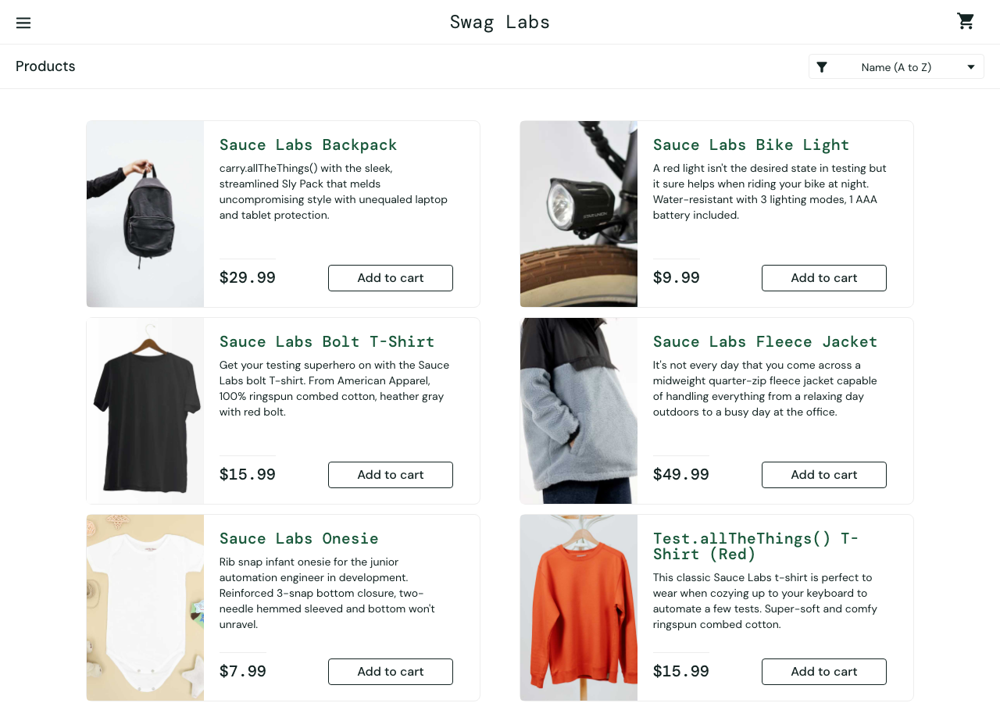
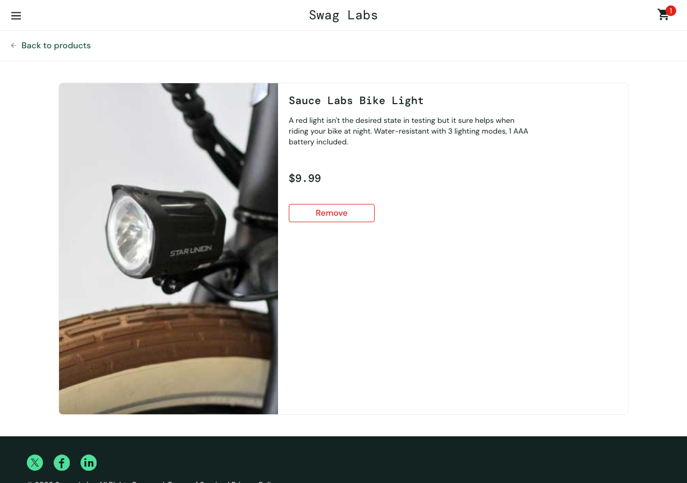

# Run 1 - standard_user - mission core

Model: `claude (your plan) / claude-opus-5-5` · Outcome: **completed** · Duration: 325s · Findings: 0

| Step | Action | Result | Screenshot |
|---|---|---|---|
| [1](#step-1) | Log in with the given account. | ⚠️ unsure | [screenshot](steps/S01.png) |
| [2](#step-2) | Add **Sauce Labs Backpack** and **Sauce Labs Bike Light** to the cart. | ✅ pass | [screenshot](steps/S02.png) |
| [3](#step-3) | Open the cart. | ⚠️ unsure | [screenshot](steps/S03.png) |
| [4](#step-4) | Start checkout. | ⚠️ unsure | [screenshot](steps/S04.png) |
| [5](#step-5) | Enter valid customer information (First Name `Test`, Last Name `User`, Postal Code `12345` | ✅ pass | [screenshot](steps/S05.png) |
| [6](#step-6) | Continue to the order overview. | ⚠️ unsure | [screenshot](steps/S06.png) |
| [7](#step-7) | Finish the order. | ✅ pass | [screenshot](steps/S07.png) |
| [8](#step-8) | Free exploration: try other paths inside this mission's theme (the AI chooses) | ⚠️ unsure | [screenshot](steps/S08.png) |

---

## Step 1 ⚠️

[↑ back to summary](#top) · jump to [screenshot](#step-1-shot)

**Action:** Log in with the given account.

**Agent report:** Logged in successfully. I typed "standard_user" into Username and "secret_sauce" into Password, then clicked "Login" (all three actions returned ok). The browser went to https://www.saucedemo.com/inventory.html. That page shows the header "Swag Labs", the title "Products" and the sort dropdown set to "Name (A to Z)" (value "az"). It lists 6 items, starting with Sauce Labs Backpack at $29.99, and each has an "Add to cart" button. The cart is empty (no badge).

**Agent actions (4):**

- 1. type [1] "Username" text="standard_user" -> ok; now at /
- 2. type [2] "Password" text="secret_sauce" -> ok; now at /
- 3. click [3] "Login" -> ok; now at /inventory.html

**Pages visited:** /, /inventory.html

| Check | Expected | Observed | Result |
|---|---|---|---|
| F1 | Valid credentials (standard_user / secret_sauce) log the user in and land on the products page | Page facts: URL is https://www.saucedemo.com/inventory.html, no error message. The visible text shows 'Swag Labs', 'Products' and the sort dropdown, and 6 items are listed, each with an 'Add to cart' button. The page facts match the agent report. | ✅ pass |
| F3 | The cart badge count equals the number of items in the cart (none yet after login) | cart_badge is null and every item button reads 'Add to cart', so the cart is empty and no badge shows. | ✅ pass |
| C1 | Each product's name, image, description and price match each other on the products list | Each item's image file matches its name (backpack, bike-light, bolt-shirt, red-onesie, red-tatt). The Fleece Jacket uses 'sauce-pullover', which is the usual asset for that product. Each description fits its product. Backpack $29.99 and Bike Light $9.99. No mismatch is seen in the list. The detail pages are not checked yet. | ✅ pass |
| C5 | No unexpected console errors or failed network requests | 6 console entries, 6 failed requests to events.backtrace.io (third-party only, no visible problem by itself) | ⚠️ unsure |

Console: ['[error] Failed to load resource: the server responded with a status of 401 (Unauthorized)', '[error] Failed to load resource: the server responded with a status of 401 (Unauthorized)', '[error] Failed to load resource: the server responded with a status of 401 (Unauthorized)', '[error] Failed to load resource: the server responded with a status of 401 (Unauthorized)', '[error] Failed to load resource: the server responded with a status of 401 (Unauthorized)', '[error] Failed to load resource: the server responded with a status of 401 (Unauthorized)']  
Failed requests: ['401 POST https://events.backtrace.io/api/unique-events/submit?universe=UNIVERSE&token=TOKEN', '401 POST https://events.backtrace.io/api/summed-events/submit?universe=UNIVERSE&token=TOKEN', '401 POST https://events.backtrace.io/api/summed-events/submit?universe=UNIVERSE&token=TOKEN', '401 POST https://events.backtrace.io/api/unique-events/submit?universe=UNIVERSE&token=TOKEN', '401 POST https://events.backtrace.io/api/summed-events/submit?universe=UNIVERSE&token=TOKEN', '401 POST https://events.backtrace.io/api/unique-events/submit?universe=UNIVERSE&token=TOKEN']

**Outcome** - [steps/S01.png](steps/S01.png) · 55s

---

## Step 2 ✅

[↑ back to summary](#top) · jump to [screenshot](#step-2-shot)

**Action:** Add **Sauce Labs Backpack** and **Sauce Labs Bike Light** to the cart.

**Agent report:** I added Sauce Labs Backpack ($29.99) and Sauce Labs Bike Light ($9.99) to the cart from /inventory.html. Both clicks show "ok", and both items' buttons now read "Remove". The cart badge shows 2. All other items still show "Add to cart". I didn't open the cart page.

**Agent actions (3):**

- 1. click [6] "Add to cart" -> ok; now at /inventory.html
- 2. click [9] "Add to cart" -> ok; now at /inventory.html

**Pages visited:** /inventory.html

| Check | Expected | Observed | Result |
|---|---|---|---|
| F2 | Clicking 'Add to cart' on Sauce Labs Backpack and Sauce Labs Bike Light adds those products, and their buttons change to 'Remove' | Page facts: Sauce Labs Backpack button = 'Remove', Sauce Labs Bike Light button = 'Remove'. The other 4 products still show 'Add to cart', so no other product was added by mistake. | ✅ pass |
| F3 | The cart badge count equals the number of items in the cart (2) | cart_badge = '2'. Exactly 2 products show 'Remove'. The cart contents are not checked until step 3. | ✅ pass |
| C1 | Each product's name, image, description and price match each other on the products page | Names, prices ($29.99, $9.99, $15.99, $49.99, $7.99, $15.99), image files (backpack, bike-light, bolt-shirt, sauce-pullover for the Fleece Jacket, red-onesie, red-tatt) and descriptions all match their products. There is no sign of mismatched images. Cross-page consistency isn't checked yet. | ✅ pass |
| C5 | No unexpected console errors or failed network requests | 0 console entries, 0 failed requests | ✅ pass |

**Outcome** - [steps/S02.png](steps/S02.png) · 38s

---

## Step 3 ⚠️

[↑ back to summary](#top) · jump to [screenshot](#step-3-shot)

**Action:** Open the cart.

**Agent report:** I clicked the cart icon (badge "2"). That opened the cart at https://www.saucedemo.com/cart.html with the heading "Your Cart". There are 2 items in it, each with quantity 1: "Sauce Labs Backpack" for $29.99 and "Sauce Labs Bike Light" for $9.99. Each item has a "Remove" button. The page also shows the "Continue Shopping" and "Checkout" buttons. The cart badge reads 2.

**Agent actions (2):**

- 1. click [2] "2" -> ok; now at /cart.html

**Pages visited:** /cart.html

| Check | Expected | Observed | Result |
|---|---|---|---|
| F3 | Cart badge count equals number of items in the cart (2) | cart_badge "2"; cart lists 2 items (Sauce Labs Backpack, Sauce Labs Bike Light), each QTY 1 | ✅ pass |
| F4 | Cart contains exactly Sauce Labs Backpack and Sauce Labs Bike Light with correct names, prices and quantities | Items: Sauce Labs Backpack $29.99 QTY 1, Sauce Labs Bike Light $9.99 QTY 1, each with a Remove button; no other items. Matches the agent report | ✅ pass |
| C1 | Each product's name, image, description and price match each other everywhere it appears | Names, descriptions and prices fit each other (Backpack: Sly Pack description, $29.99; Bike Light: red light description, $9.99). Image is null for both items in the page facts, and this step has no product-list facts to compare against, so image consistency can't be judged | ⚠️ unsure |
| C4 | No layout breakage, overlapping elements or unreadable text | Page facts contain only text and data, no layout or visual information; the visible text is complete and in order | ⚠️ unsure |
| C5 | No unexpected console errors or failed network requests | 0 console entries, 0 failed requests | ✅ pass |

**Outcome** - [steps/S03.png](steps/S03.png) · 30s

---

## Step 4 ⚠️

[↑ back to summary](#top) · jump to [screenshot](#step-4-shot)

**Action:** Start checkout.

**Agent report:** Checkout has started. I clicked "Checkout" and the page went to https://www.saucedemo.com/checkout-step-one.html. The page title is "Checkout: Your Information" and the cart badge shows 2. The form has three empty fields (First Name, Last Name, Zip/Postal Code) and two buttons, "Cancel" and "Continue". I did not fill in the form; that is a later step.

**Agent actions (2):**

- 1. click [8] "Checkout" -> ok; now at /checkout-step-one.html

**Pages visited:** /checkout-step-one.html

| Check | Expected | Observed | Result |
|---|---|---|---|
| C2 | Clicking "Checkout" in the cart opens the checkout information page (checkout-step-one) titled "Checkout: Your Information". | URL is https://www.saucedemo.com/checkout-step-one.html and the visible text includes "Checkout: Your Information". The page shows a Cancel control and no error message. | ✅ pass |
| F3 | The cart badge still equals the 2 items in the cart (Backpack and Bike Light from step 2), with nothing changed by navigating. | cart_badge = "2". | ✅ pass |
| F5 | The checkout form shows empty First Name, Last Name and Postal Code fields, ready for input. Whether it accepts and keeps the values is tested in step 5. | The inputs first-name, last-name and postal-code are present and all empty (""), with no error message. The page facts do not show whether the "Continue" button exists: it is likely an input element, so it does not appear in visible_text. That claim comes only from the agent report. Accepting and keeping the values has not been tested yet. | ⚠️ unsure |
| C5 | No unexpected console errors or failed network requests | 0 console entries, 0 failed requests | ✅ pass |

**Outcome** - [steps/S04.png](steps/S04.png) · 31s

---

## Step 5 ✅

[↑ back to summary](#top) · jump to [screenshot](#step-5-shot)

**Action:** Enter valid customer information (First Name `Test`, Last Name `User`, Postal Code `12345`).

**Agent report:** Step 5 is done: the customer information is entered on the Checkout: Your Information page (/checkout-step-one.html). The page shows First Name = "Test", Last Name = "User" and Zip/Postal Code = "12345". I did not click "Continue", because that belongs to a later step. No error message is shown, and the cart badge reads 2.

**Agent actions (4):**

- 1. type [3] "First Name" text="Test" -> ok; now at /checkout-step-one.html
- 2. type [4] "Last Name" text="User" -> ok; now at /checkout-step-one.html
- 3. type [5] "Zip/Postal Code" text="12345" -> ok; now at /checkout-step-one.html

**Pages visited:** /checkout-step-one.html

| Check | Expected | Observed | Result |
|---|---|---|---|
| F5 | First Name, Last Name and Postal Code fields hold exactly what was typed: 'Test', 'User', '12345' (TS-002 read-back), and no error appears for valid input. | The page facts read the fields back as first-name='Test', last-name='User', postal-code='12345'. error_message is null. The URL is /checkout-step-one.html. This matches the agent report. 'Accepts' can only be fully confirmed after Continue, which is step 6. | ✅ pass |
| F3 | The cart badge equals the number of items in the cart (2: Backpack and Bike Light). | The cart badge reads '2'. That fits the two products selected in earlier steps. This page lists no items, so the badge cannot be compared with a list here. | ✅ pass |
| C5 | No unexpected console errors or failed network requests | 0 console entries, 0 failed requests | ✅ pass |

**Outcome** - [steps/S05.png](steps/S05.png) · 48s

---

## Step 6 ⚠️

[↑ back to summary](#top) · jump to [screenshot](#step-6-shot)

**Action:** Continue to the order overview.

**Agent report:** I clicked "Continue" and the browser went to /checkout-step-two.html, which shows the "Checkout: Overview" page. It lists 2 items, each with quantity 1: Sauce Labs Backpack at $29.99 and Sauce Labs Bike Light at $9.99. Payment Information is "SauceCard #31337" and Shipping Information is "Free Pony Express Delivery!". The totals are Item total $39.98, Tax $3.20 and Total $43.18. The page has "Cancel" and "Finish" buttons. I did not click Finish because that is a later step.

**Agent actions (2):**

- 1. click [7] "Continue" -> ok; now at /checkout-step-two.html

**Pages visited:** /checkout-step-two.html

| Check | Expected | Observed | Result |
|---|---|---|---|
| F6 | The overview lists the same items as the cart (Sauce Labs Backpack and Sauce Labs Bike Light, quantity 1 each). Item total equals the sum of the item prices, and Total equals Item total plus Tax. | URL /checkout-step-two.html shows 'Checkout: Overview' with 2 items, quantity 1 each: Sauce Labs Backpack $29.99 and Sauce Labs Bike Light $9.99. Item total is $39.98 (29.99 + 9.99 = 39.98, correct). Tax is $3.20. Total is $43.18 (39.98 + 3.20 = 43.18, correct). Cart badge is 2 and there is no error message. The agent report matches the page facts. | ✅ pass |
| C1 | Each product's name, description and price are the same here as everywhere else it appears. | Names, prices ($29.99 and $9.99) and descriptions ('carry.allTheThings()...' for the Backpack, 'A red light isn't the desired state...' for the Bike Light) belong to the right products and agree with each other. The overview shows no images, which is normal for this page. | ✅ pass |
| C4 | No broken layout, overlapping elements or unreadable text. | The page facts include only text and DOM data, with no visual or screenshot evidence. Layout cannot be judged. | ⚠️ unsure |
| C5 | No unexpected console errors or failed network requests | 0 console entries, 0 failed requests | ✅ pass |

**Outcome** - [steps/S06.png](steps/S06.png) · 31s

---

## Step 7 ✅

[↑ back to summary](#top) · jump to [screenshot](#step-7-shot)

**Action:** Finish the order.

**Agent report:** I clicked "Finish" (it showed as ok), and the browser went to /checkout-complete.html. That page has the heading "Checkout: Complete!" and the messages "Thank you for your order!" and "Your order has been dispatched, and will arrive just as fast as the pony can get there!" The cart badge is gone and the cart link reads "Cart, empty". There are two buttons on the page, "Back Home" and "Generate PDF order", and I didn't click either one. Nothing looked wrong.

**Agent actions (2):**

- 1. click [6] "Finish" -> ok; now at /checkout-complete.html

**Pages visited:** /checkout-complete.html

| Check | Expected | Observed | Result |
|---|---|---|---|
| F7 | Clicking Finish shows an order confirmation, and the cart is empty afterwards (no badge, no items). | URL is /checkout-complete.html. The visible text includes 'Checkout: Complete!', 'Thank you for your order!' and 'Your order has been dispatched...'. cart_badge is null, items is empty, and there is no error message. The cart page itself was not opened to confirm it is empty, so the empty cart is inferred from the missing badge. The agent's claim that the cart link reads 'Cart, empty' does not appear in the page facts. | ✅ pass |
| C5 | No unexpected console errors or failed network requests | 0 console entries, 0 failed requests | ✅ pass |

**Outcome** - [steps/S07.png](steps/S07.png) · 29s

---

## Step 8 ⚠️

[↑ back to summary](#top) · jump to [screenshot](#step-8-shot)

**Action:** Free exploration: try other paths inside this mission's theme (the AI chooses)

**Agent report:** (no final report: the agent ran out of actions or could not continue) Last actions: 4. click [4] "Add to cart" -> ok; now at /inventory-item.html | 5. (your answer was not valid JSON for the action format) | 6. (your answer was not valid JSON for the action format) | 7. (your answer was not valid JSON for the action format)

**Agent actions (4):**

- 1. click [3] "Back Home" -> ok; now at /inventory.html
- 2. select [3] "Name (A to Z) Name (Z to A) Price (low to high) Price (high " text="Price (low to high)" -> ok; now at /inventory.html
- 3. click [8] "Sauce Labs Bike Light" -> ok; now at /inventory-item.html
- 4. click [4] "Add to cart" -> ok; now at /inventory-item.html

**Pages visited:** /inventory.html, /inventory-item.html

| Check | Expected | Observed | Result |
|---|---|---|---|
| - | the judge returns checks | judge failed: claude failed: {"duration_api_ms":0,"stop_reason":"stop_sequence","session_id":"9ad3f1c0-d151-450f-86e5-1f0354039e76","total_cost_usd":0,"usage":{"output_tokens_details":{"thinking_tokens":0},"input_tokens":0,"cache_creation_input_tokens":0,"cache_read_input_tokens":0,"output_tokens":0,"server_tool_ | ⚠️ unsure |
| C5 | No unexpected console errors or failed network requests | 0 console entries, 0 failed requests | ✅ pass |

**Outcome** - [steps/S08.png](steps/S08.png) · 54s

