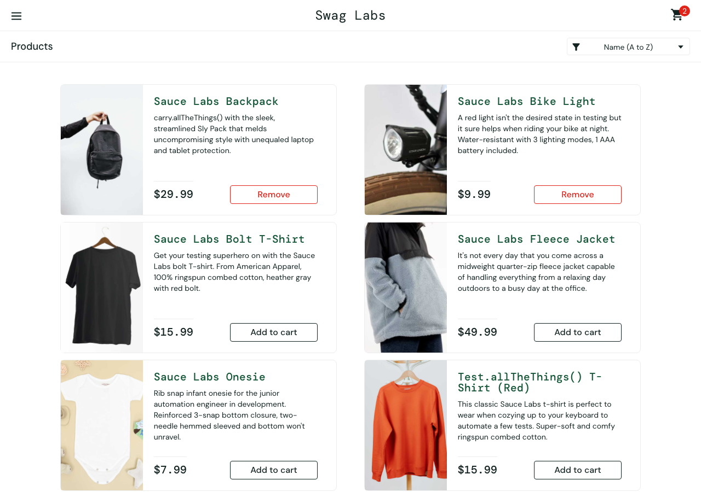
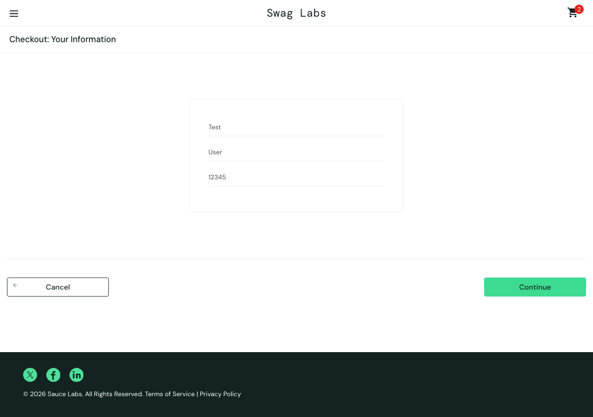
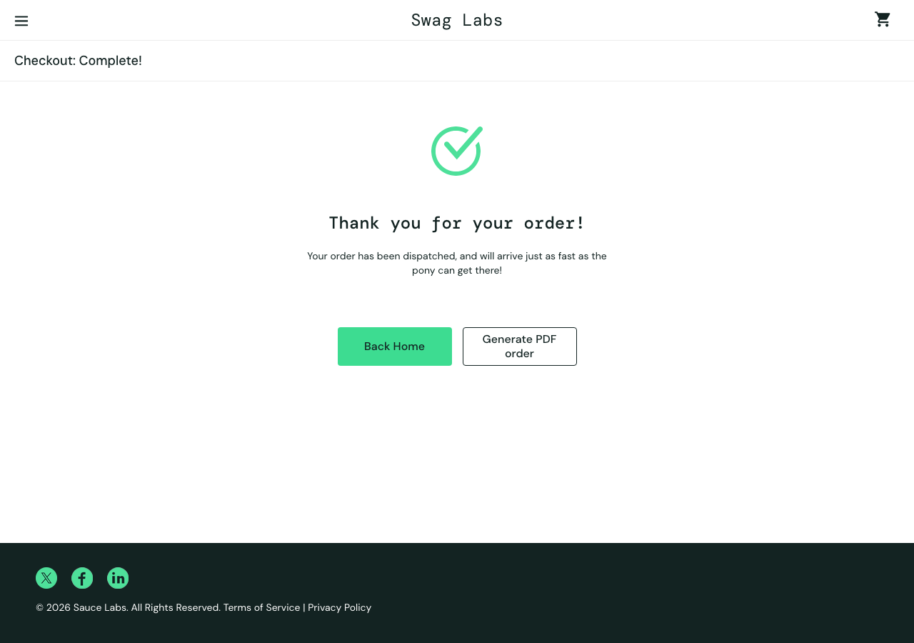
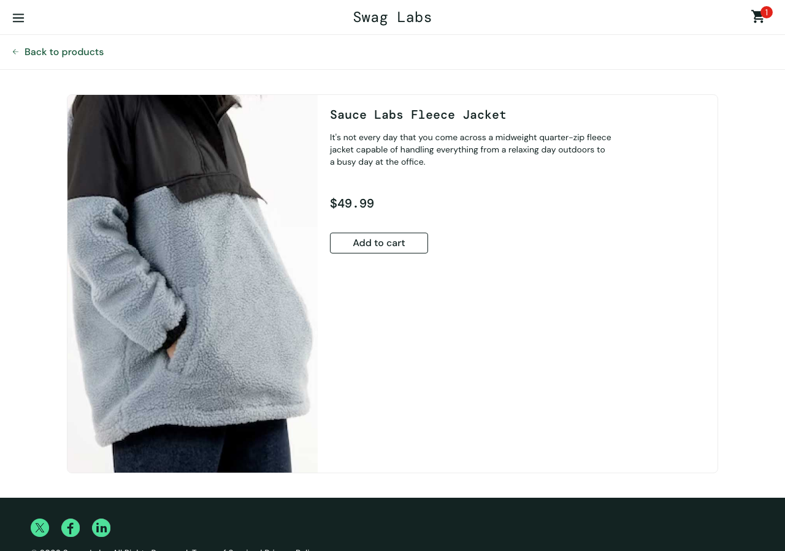

# Run 2 - standard_user - mission core

Model: `claude (your plan) / claude-haiku-5-5` · Outcome: **completed** · Duration: 254s · Findings: 2

| Step | Action | Result | Screenshot |
|---|---|---|---|
| [1](#step-1) | Log in with the given account. | ⚠️ unsure | [screenshot](steps/S01.png) |
| [2](#step-2) | Add **Sauce Labs Backpack** and **Sauce Labs Bike Light** to the cart. | ⚠️ unsure | [screenshot](steps/S02.png) |
| [3](#step-3) | Open the cart. | ⚠️ unsure | [screenshot](steps/S03.png) |
| [4](#step-4) | Start checkout. | ⚠️ unsure | [screenshot](steps/S04.png) |
| [5](#step-5) | Enter valid customer information (First Name `Test`, Last Name `User`, Postal Code `12345` | ✅ pass | [screenshot](steps/S05.png) |
| [6](#step-6) | Continue to the order overview. | ⚠️ unsure | [screenshot](steps/S06.png) |
| [7](#step-7) | Finish the order. | ⚠️ unsure | [screenshot](steps/S07.png) |
| [8](#step-8) | Free exploration: try other paths inside this mission's theme (the AI chooses) | ⚠️ unsure | [screenshot](steps/S08.png) |

---

## Step 1 ⚠️

[↑ back to summary](#top) · jump to [screenshot](#step-1-shot)

**Action:** Log in with the given account.

**Agent report:** Step 1 complete. Typed "standard_user" into Username and "secret_sauce" into Password, then clicked Login. The page moved to https://www.saucedemo.com/inventory.html and shows the "Products" heading with the item list (Sauce Labs Backpack, Bike Light, Bolt T-Shirt, Fleece Jacket, Onesie, Test.allTheThings() T-Shirt (Red)). Cart badge is empty.

**Agent actions (4):**

- 1. type [1] "Username" text="standard_user" -> ok; now at /
- 2. type [2] "Password" text="secret_sauce" -> ok; now at /
- 3. click [3] "Login" -> ok; now at /inventory.html

**Pages visited:** /, /inventory.html

| Check | Expected | Observed | Result |
|---|---|---|---|
| F1 | Valid credentials log the user in and land on the products page | After submitting standard_user / secret_sauce, the URL is https://www.saucedemo.com/inventory.html, the page shows the 'Products' heading and six products with 'Add to cart' buttons. Cart badge is null (empty), consistent with the agent report. | ✅ pass |
| C5 | No unexpected console errors or failed network requests | 4 console entries, 4 failed requests to events.backtrace.io (third-party only, no visible problem by itself) | ⚠️ unsure |

Console: ['[error] Failed to load resource: the server responded with a status of 401 (Unauthorized)', '[error] Failed to load resource: the server responded with a status of 401 (Unauthorized)', '[error] Failed to load resource: the server responded with a status of 401 (Unauthorized)', '[error] Failed to load resource: the server responded with a status of 401 (Unauthorized)']  
Failed requests: ['401 POST https://events.backtrace.io/api/unique-events/submit?universe=UNIVERSE&token=TOKEN', '401 POST https://events.backtrace.io/api/summed-events/submit?universe=UNIVERSE&token=TOKEN', '401 POST https://events.backtrace.io/api/unique-events/submit?universe=UNIVERSE&token=TOKEN', '401 POST https://events.backtrace.io/api/summed-events/submit?universe=UNIVERSE&token=TOKEN']

**Outcome** - [steps/S01.png](steps/S01.png) · 31s

---

## Step 2 ⚠️

[↑ back to summary](#top) · jump to [screenshot](#step-2-shot)

**Action:** Add **Sauce Labs Backpack** and **Sauce Labs Bike Light** to the cart.

**Agent report:** Step 2 complete. I clicked "Add to cart" for Sauce Labs Backpack and Sauce Labs Bike Light on /inventory.html. Both now show "Remove" buttons, and the cart badge shows 2.

**Agent actions (3):**

- 1. click [6] "Add to cart" -> ok; now at /inventory.html
- 2. click [9] "Add to cart" -> ok; now at /inventory.html

**Pages visited:** /inventory.html

| Check | Expected | Observed | Result |
|---|---|---|---|
| F2 | Clicking "Add to cart" adds that specific product and its button changes to "Remove" (Sauce Labs Backpack and Sauce Labs Bike Light). | Sauce Labs Backpack ($29.99) and Sauce Labs Bike Light ($9.99) both show "Remove". The other four products (Bolt T-Shirt, Fleece Jacket, Onesie, Test.allTheThings() T-Shirt) still show "Add to cart", so only the selected items changed. | ✅ pass |
| F3 | Cart badge count equals the number of items in the cart (2 after adding two products). | Cart badge shows "2". Exactly two products show "Remove", consistent with two items added. The cart itself has not been opened in this step, so the list-level count is the only evidence here; the cart contents are checked in a later step. | ✅ pass |
| C1 | Product names, images and prices on the products list match each other for the two added products. | Sauce Labs Backpack: name, image file sauce-backpack, price $29.99. Sauce Labs Bike Light: name, image file bike-light, price $9.99. Image filenames match the product names. Visible descriptions are consistent with the names. Only the list page was checked. | ✅ pass |
| C5 | No unexpected console errors or failed network requests | 2 console entries, 2 failed requests to events.backtrace.io (third-party only, no visible problem by itself) | ⚠️ unsure |

Console: ['[error] Failed to load resource: the server responded with a status of 401 (Unauthorized)', '[error] Failed to load resource: the server responded with a status of 401 (Unauthorized)']  
Failed requests: ['401 POST https://events.backtrace.io/api/unique-events/submit?universe=UNIVERSE&token=TOKEN', '401 POST https://events.backtrace.io/api/summed-events/submit?universe=UNIVERSE&token=TOKEN']

**Outcome** - [steps/S02.png](steps/S02.png) · 25s

---

## Step 3 ⚠️

[↑ back to summary](#top) · jump to [screenshot](#step-3-shot)

**Action:** Open the cart.

**Agent report:** Step 3 complete. The cart is open at https://www.saucedemo.com/cart.html. The page shows "Your Cart" with the badge at 2 and two items: Sauce Labs Backpack (qty 1, $29.99) and Sauce Labs Bike Light (qty 1, $9.99). "Continue Shopping" and "Checkout" buttons are visible. I did not take any later steps.

**Agent actions (2):**

- 1. click [2] "2" -> ok; now at /cart.html

**Pages visited:** /cart.html

| Check | Expected | Observed | Result |
|---|---|---|---|
| F3 | Cart badge count equals the number of items actually in the cart | Cart badge reads "2" and the cart lists exactly two items (Sauce Labs Backpack, Sauce Labs Bike Light). | ✅ pass |
| F4 | Cart contains exactly the selected products with correct names, prices and quantities | Items are Sauce Labs Backpack ($29.99, qty 1) and Sauce Labs Bike Light ($9.99, qty 1). These are the two products the mission asked for, and no others appear. | ✅ pass |
| C1 | A product's name, image, description and price match each other everywhere it appears | Names and prices are shown on the cart page, but this step's facts contain no product-list values to compare against. Both item image fields are null, so image consistency cannot be read here. | ⚠️ unsure |
| C4 | No layout breakage, overlapping elements, or unreadable text in the flow | Visible text reads in logical order with Continue Shopping and Checkout buttons present. The facts contain no layout or overlap data, so visual layout cannot be judged from them. | ⚠️ unsure |
| C5 | No unexpected console errors or failed network requests | 0 console entries, 0 failed requests | ✅ pass |

**Outcome** - [steps/S03.png](steps/S03.png) · 18s

---

## Step 4 ⚠️

[↑ back to summary](#top) · jump to [screenshot](#step-4-shot)

**Action:** Start checkout.

**Agent report:** Step 4 (Start checkout) is complete. I clicked "Checkout" in the cart (ok). The page is now https://www.saucedemo.com/checkout-step-one.html and shows the heading "Checkout: Your Information". It has empty First Name, Last Name and Zip/Postal Code fields, plus "Cancel" and "Continue" buttons. The cart badge shows 2. I did not fill in the form or click Continue, since those belong to later steps.

**Agent actions (2):**

- 1. click [8] "Checkout" -> ok; now at /checkout-step-one.html

**Pages visited:** /checkout-step-one.html

| Check | Expected | Observed | Result |
|---|---|---|---|
| C2 | Clicking the Checkout button opens the checkout page that the label describes (Checkout: Your Information). | URL is https://www.saucedemo.com/checkout-step-one.html and the heading reads 'Checkout: Your Information'. | ✅ pass |
| F3 | Cart badge count equals the number of items actually in the cart. | Badge reads 2. This step did not read the cart contents, and the checkout information page does not list items (items: []), so the badge cannot be compared with the actual cart list here. | ⚠️ unsure |
| C4 | No layout breakage, overlapping elements, or unreadable text on the checkout information page. | Visible text is readable and in order (heading, Cancel/Continue, footer). Only text and field values were captured; no visual or overlap check was made. | ⚠️ unsure |
| C5 | No unexpected console errors or failed network requests | 0 console entries, 0 failed requests | ✅ pass |

**Outcome** - [steps/S04.png](steps/S04.png) · 18s

---

## Step 5 ✅

[↑ back to summary](#top) · jump to [screenshot](#step-5-shot)

**Action:** Enter valid customer information (First Name `Test`, Last Name `User`, Postal Code `12345`).

**Agent report:** Step 5 complete. On https://www.saucedemo.com/checkout-step-one.html ("Checkout: Your Information"), I typed into the three fields and the page shows these values: First Name = "Test" [3], Last Name = "User" [4], Zip/Postal Code = "12345" [5]. I did not click Continue [7] because that belongs to a later step. Cart badge shows 2.

**Agent actions (4):**

- 1. type [3] "First Name" text="Test" -> ok; now at /checkout-step-one.html
- 2. type [4] "Last Name" text="User" -> ok; now at /checkout-step-one.html
- 3. type [5] "Zip/Postal Code" text="12345" -> ok; now at /checkout-step-one.html

**Pages visited:** /checkout-step-one.html

| Check | Expected | Observed | Result |
|---|---|---|---|
| F5 | Checkout accepts valid First Name, Last Name and Postal Code, and each field keeps exactly what was typed (First Name 'Test', Last Name 'User', Postal Code '12345'). | Page facts show inputs first-name='Test', last-name='User', postal-code='12345', with error_message null and the URL still on checkout-step-one.html. The agent report agrees with these values. | ✅ pass |
| C5 | No unexpected console errors or failed network requests | 0 console entries, 0 failed requests | ✅ pass |

**Outcome** - [steps/S05.png](steps/S05.png) · 31s

---

## Step 6 ⚠️

[↑ back to summary](#top) · jump to [screenshot](#step-6-shot)

**Action:** Continue to the order overview.

**Agent report:** Step 6 complete. I clicked "Continue" on checkout step one, and the browser is now at https://www.saucedemo.com/checkout-step-two.html, showing "Checkout: Overview". Items: 1 x Sauce Labs Backpack ($29.99) and 1 x Sauce Labs Bike Light ($9.99). Payment Information: SauceCard #31337. Shipping Information: Free Pony Express Delivery! Item total: $39.98, Tax: $3.20, Total: $43.18. Buttons available: Cancel and Finish. I did not click Finish, as it belongs to a later step. Cart badge shows 2.

**Agent actions (2):**

- 1. click [7] "Continue" -> ok; now at /checkout-step-two.html

**Pages visited:** /checkout-step-two.html

| Check | Expected | Observed | Result |
|---|---|---|---|
| F6 | Overview lists the same items as the cart; item total equals the sum of item prices; total equals item total plus tax | Overview lists Sauce Labs Backpack ($29.99, qty 1) and Sauce Labs Bike Light ($9.99, qty 1). Item total $39.98 = 29.99 + 9.99. Tax $3.20. Total $43.18 = 39.98 + 3.20. Badge reads 2. The cart contents themselves were not captured in this step's page facts, so the cart-to-overview comparison rests on the two named items matching the mission selection and the badge count. | ✅ pass |
| C1 | Product name, image, description and price match each other wherever the product appears | Names and prices are shown on the overview. Descriptions are present for both items. Image is null in the page facts, so image cannot be compared. No product list from this step is available to compare against. | ⚠️ unsure |
| C2 | Navigation goes where the label says | Clicking Continue on checkout step one led to https://www.saucedemo.com/checkout-step-two.html, and the page heading reads 'Checkout: Overview'. | ✅ pass |
| C3 | Error messages are accurate; no false error when none is expected | error_message is null. No error is expected on a valid overview page, and none is shown. | ✅ pass |
| C4 | No layout breakage, overlapping elements, or unreadable text | Visible text reads in a logical order with the QTY, description, price, payment, shipping, totals and Cancel/Finish buttons. No visual or layout data was captured, so overlap cannot be assessed. | ⚠️ unsure |
| C5 | No unexpected console errors or failed network requests | 0 console entries, 0 failed requests | ✅ pass |

**Outcome** - [steps/S06.png](steps/S06.png) · 21s

---

## Step 7 ⚠️

[↑ back to summary](#top) · jump to [screenshot](#step-7-shot)

**Action:** Finish the order.

**Agent report:** Step 7 (Finish the order) is complete. Action 1 clicked "Finish" and returned ok. The page is now https://www.saucedemo.com/checkout-complete.html and shows the heading "Checkout: Complete!" with the text "Thank you for your order!" and "Your order has been dispatched, and will arrive just as fast as the pony can get there!" The cart badge shows "Cart, empty". The "Back Home" and "Generate PDF order" buttons are present but were not clicked.

**Agent actions (2):**

- 1. click [6] "Finish" -> ok; now at /checkout-complete.html

**Pages visited:** /checkout-complete.html

| Check | Expected | Observed | Result |
|---|---|---|---|
| F7 | Finishing shows an order confirmation, and the cart is empty afterwards | URL is checkout-complete.html. Visible text includes 'Checkout: Complete!' and 'Thank you for your order!' and the dispatch message. cart_badge is null, and items is empty. | ✅ pass |
| C4 | No layout breakage, overlapping elements, or unreadable text on the confirmation page | The page facts contain visible text only, with no layout, overlap or visibility data. The agent report does not describe layout either. | ⚠️ unsure |
| C5 | No unexpected console errors or failed network requests | 0 console entries, 0 failed requests | ✅ pass |

**Outcome** - [steps/S07.png](steps/S07.png) · 19s

---

## Step 8 ⚠️

[↑ back to summary](#top) · jump to [screenshot](#step-8-shot)

**Action:** Free exploration: try other paths inside this mission's theme (the AI chooses)

**Agent report:** PATH: Opened the Sauce Labs Backpack detail page from the product list (click on "Sauce Labs Backpack"), then used "Back to products". Landed on /inventory.html. Did not compare name, image, price or description to the list, so no match check was done for this path.
PATH: Sort dropdown set to "Price (low to high)" on /inventory.html (ok, still on /inventory.html). I did not read the resulting product order or prices from the page, so I cannot confirm the order matches the label.
PATH: Sort dropdown changed to "Price (high to low)" on /inventory.html (ok, still on /inventory.html). I did not read the resulting product order, so I cannot confirm the order matches the label.
PATH: Opened the Sauce Labs Fleece Jacket detail page (/inventory-item.html?id=5). Page text shows: "Sauce Labs Fleece Jacket", description "It's not every day that you come across a midweight quarter-zip fleece jacket capable of handling everything from a relaxing day outdoors to a busy day at the office.", price "$49.99", button "Add to cart". Cart badge shows 1. I did not compare these against the product list, and I did not check the image.
PATH: Earlier steps in the log: clicked "Remove" (4) and "Add to cart" (5) on /inventory-item.html, then clicked the cart badge "1" (6), which went to /cart.html. The log says these were ok, but I did not record the badge count or cart contents at each step, so I cannot confirm whether the badge followed each change.
Summary: 12 of 12 actions used. Not verified: product list vs detail page match (name, image, price, description), sort order vs label, and badge updates after remove/re-add. The only page text I actually read is the Fleece Jacket detail page.

**Agent actions (12):**

- 1. click [3] "Back Home" -> ok; now at /inventory.html
- 2. click [5] "Sauce Labs Backpack" -> ok; now at /inventory-item.html
- 3. click [4] "Add to cart" -> ok; now at /inventory-item.html
- 4. click [4] "Remove" -> ok; now at /inventory-item.html
- 5. click [4] "Add to cart" -> ok; now at /inventory-item.html
- 6. click [2] "1" -> ok; now at /cart.html
- 7. click [3] "Sauce Labs Backpack" -> ok; now at /inventory-item.html
- 8. click [3] "Back to products" -> ok; now at /inventory.html
- 9. select [3] "Name (A to Z) Name (Z to A) Price (low to high) Price (high " text="Price (low to high)" -> ok; now at /inventory.html
- 10. select [3] "Name (A to Z) Name (Z to A) Price (low to high) Price (high " text="Price (high to low)" -> ok; now at /inventory.html
- 11. click [5] "Sauce Labs Fleece Jacket" -> ok; now at /inventory-item.html

**Pages visited:** /inventory.html, /inventory-item.html, /cart.html

| Check | Expected | Observed | Result |
|---|---|---|---|
| C1 | Product name, image, description and price match between the product list and the detail page (checked for the paths explored) | Fleece Jacket detail page shows name 'Sauce Labs Fleece Jacket', description and price '$49.99'. No product list text or image was read for comparison, and the Backpack detail page was not read at all. Nothing shows a mismatch, but nothing shows a match either. | ⚠️ unsure |
| C2 | Clicking a product name opens that product's detail page | Agent reports clicking 'Sauce Labs Backpack' and then 'Back to products', but the runner recorded no page facts for the Backpack detail page. The only detail page read is the Fleece Jacket (id=5), which the agent says it opened from the list, but no list click target is confirmed in the page facts. | ⚠️ unsure |
| C4 | No layout breakage, overlapping elements, or unreadable text in the flow | Only visible text was captured for the Fleece Jacket page. No layout, overlap or screenshot evidence is in the facts. Nothing indicates a problem. | ⚠️ unsure |
| F2 | Clicking 'Add to cart' adds that product and the button changes to 'Remove' | On the Fleece Jacket detail page the button reads 'Add to cart' with cart badge 1. The agent log says it clicked 'Remove' then 'Add to cart' on this page, but the page facts do not show which product those clicks affected. The Fleece Jacket button is not 'Remove', so the Fleece Jacket is not shown as added. | ⚠️ unsure |
| F3 | Cart badge count equals the number of items actually in the cart | Badge reads 1 on the Fleece Jacket page. Cart contents were not read at any point in this step, and the badge was not recorded after each remove/re-add. The core flow expects two items, so a badge of 1 cannot be compared to a known cart count from these facts. | ⚠️ unsure |
| C5 | No unexpected console errors or failed network requests | 0 console entries, 0 failed requests | ✅ pass |

- **Finding S8-F3-1** (suspicious, observation): Cart badge reads 1 during exploration, cart contents and badge history not recorded. Observed: Badge shows 1 on the Fleece Jacket page. The agent did not read the cart contents or the badge after each remove/re-add, so it is not known whether the badge is wrong or the cart legitimately holds one item after the exploration clicks.

- **Finding S8-F2-2** (suspicious, observation): Fleece Jacket page shows 'Add to cart' after agent's add/remove clicks. Observed: Page facts show 'Add to cart' on the Fleece Jacket page with badge 1. The agent's log is unclear about which product the remove/add clicks targeted, so this may simply be a different product. Not confirmed as a fault.

**Outcome** - [steps/S08.png](steps/S08.png) · 88s

