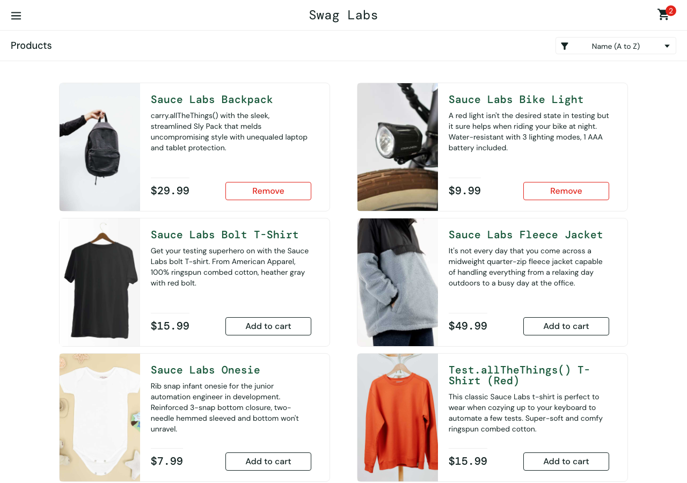
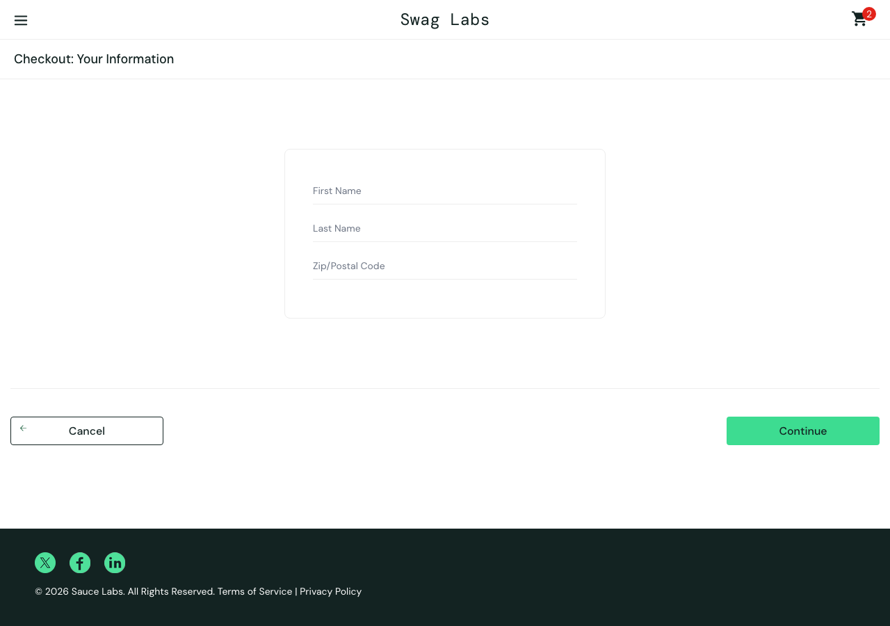
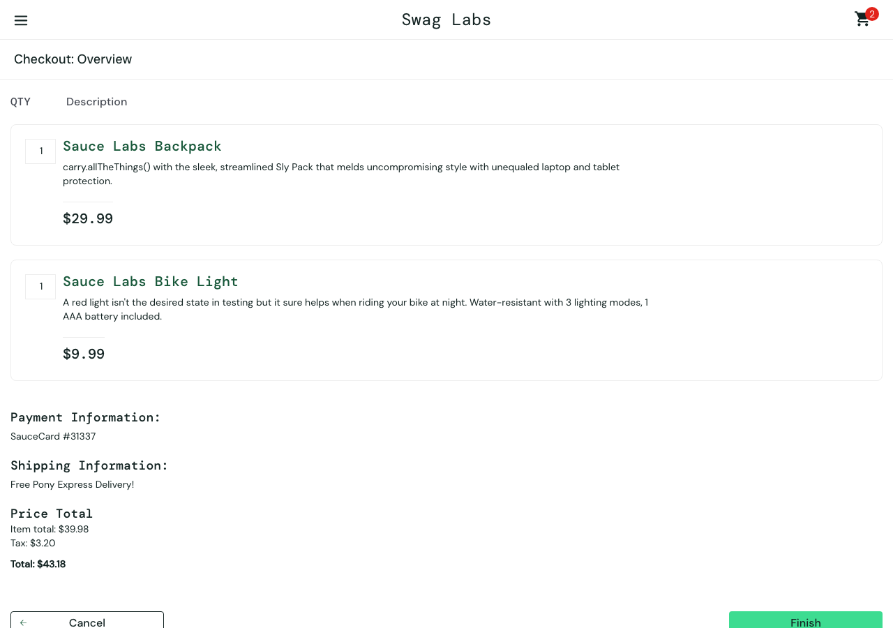
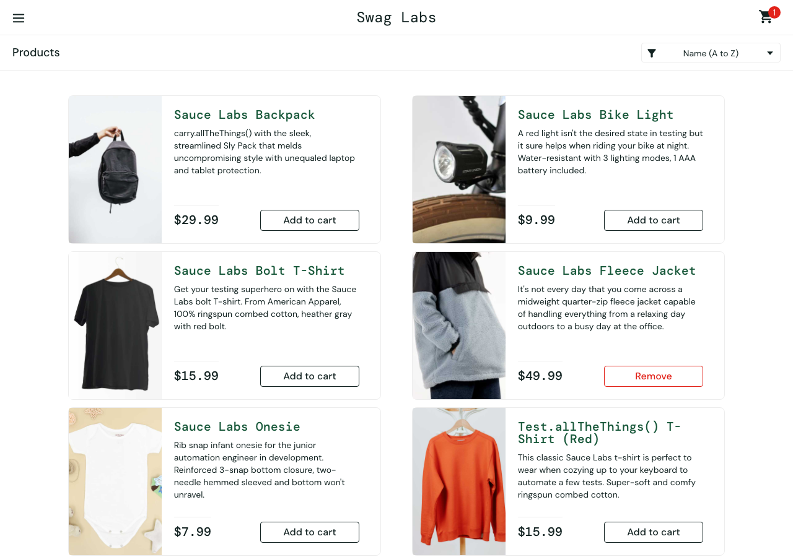

# Run 3 - standard_user - mission core

Model: `claude (your plan) / claude-haiku-5-5` · Outcome: **completed with issues** · Duration: 264s · Findings: 1

| Step | Action | Result | Screenshot |
|---|---|---|---|
| [1](#step-1) | Log in with the given account. | ⚠️ unsure | [screenshot](steps/S01.png) |
| [2](#step-2) | Add **Sauce Labs Backpack** and **Sauce Labs Bike Light** to the cart. | ⚠️ unsure | [screenshot](steps/S02.png) |
| [3](#step-3) | Open the cart. | ✅ pass | [screenshot](steps/S03.png) |
| [4](#step-4) | Start checkout. | ⚠️ unsure | [screenshot](steps/S04.png) |
| [5](#step-5) | Enter valid customer information (First Name `Test`, Last Name `User`, Postal Code `12345` | ✅ pass | [screenshot](steps/S05.png) |
| [6](#step-6) | Continue to the order overview. | ⚠️ unsure | [screenshot](steps/S06.png) |
| [7](#step-7) | Finish the order. | ⚠️ unsure | [screenshot](steps/S07.png) |
| [8](#step-8) | Free exploration: try other paths inside this mission's theme (the AI chooses) | ❌ fail | [screenshot](steps/S08.png) |

---

## Step 1 ⚠️

[↑ back to summary](#top) · jump to [screenshot](#step-1-shot)

**Action:** Log in with the given account.

**Agent report:** Step 1 of 8 complete. I logged in as standard_user (typed username and password, clicked Login). The page is now https://www.saucedemo.com/inventory.html and shows the "Products" heading with items (e.g., Sauce Labs Backpack $29.99, Sauce Labs Bike Light $9.99). The cart badge is empty ("Cart, empty"). No errors seen.

**Agent actions (4):**

- 1. type [1] "Username" text="standard_user" -> ok; now at /
- 2. type [2] "Password" text="secret_sauce" -> ok; now at /
- 3. click [3] "Login" -> ok; now at /inventory.html

**Pages visited:** /, /inventory.html

| Check | Expected | Observed | Result |
|---|---|---|---|
| F1 | Valid credentials log the user in and land on the products page | After logging in as standard_user, the URL is https://www.saucedemo.com/inventory.html, the visible text includes the 'Products' heading, and six products are listed with 'Add to cart' buttons. No error message is shown. The cart badge is null, which matches the agent's report of an empty cart. | ✅ pass |
| C5 | No unexpected console errors or failed network requests | 4 console entries, 4 failed requests to events.backtrace.io (third-party only, no visible problem by itself) | ⚠️ unsure |

Console: ['[error] Failed to load resource: the server responded with a status of 401 (Unauthorized)', '[error] Failed to load resource: the server responded with a status of 401 (Unauthorized)', '[error] Failed to load resource: the server responded with a status of 401 (Unauthorized)', '[error] Failed to load resource: the server responded with a status of 401 (Unauthorized)']  
Failed requests: ['401 POST https://events.backtrace.io/api/unique-events/submit?universe=UNIVERSE&token=TOKEN', '401 POST https://events.backtrace.io/api/summed-events/submit?universe=UNIVERSE&token=TOKEN', '401 POST https://events.backtrace.io/api/summed-events/submit?universe=UNIVERSE&token=TOKEN', '401 POST https://events.backtrace.io/api/unique-events/submit?universe=UNIVERSE&token=TOKEN']

**Outcome** - [steps/S01.png](steps/S01.png) · 33s

---

## Step 2 ⚠️

[↑ back to summary](#top) · jump to [screenshot](#step-2-shot)

**Action:** Add **Sauce Labs Backpack** and **Sauce Labs Bike Light** to the cart.

**Agent report:** Step 2 complete. Logged in as standard_user and added Sauce Labs Backpack ($29.99) and Sauce Labs Bike Light ($9.99) to the cart. The page shows the cart badge at 2, and both items now show "Remove" buttons on /inventory.html. No other items were added.

**Agent actions (3):**

- 1. click [6] "Add to cart" -> ok; now at /inventory.html
- 2. click [9] "Add to cart" -> ok; now at /inventory.html

**Pages visited:** /inventory.html

| Check | Expected | Observed | Result |
|---|---|---|---|
| F2 | Clicking 'Add to cart' adds that specific product and the button changes to 'Remove' (Backpack and Bike Light) | Sauce Labs Backpack and Sauce Labs Bike Light both show 'Remove'. The other four products still show 'Add to cart'. No other product changed. | ✅ pass |
| F3 | Cart badge count equals the number of items actually in the cart (2 items added) | Cart badge reads '2'. Two products show 'Remove', which matches the two added. The cart page itself was not opened in this step, so the badge is only checked against the list buttons. | ✅ pass |
| C1 | Product name, image and price match each other on the products list (Backpack $29.99 with backpack image; Bike Light $9.99 with bike-light image) | Backpack: name 'Sauce Labs Backpack', price '$29.99', image 'sauce-backpack-1200x1500'. Bike Light: name 'Sauce Labs Bike Light', price '$9.99', image 'bike-light-1200x1500'. Descriptions match the product names. Not yet compared against the cart or detail pages. | ✅ pass |
| C4 | No layout breakage, overlapping elements, or unreadable text on the products page | Page facts give text and button states only. No layout or overlap data was captured for this step. | ⚠️ unsure |
| C5 | No unexpected console errors or failed network requests | 2 console entries, 2 failed requests to events.backtrace.io (third-party only, no visible problem by itself) | ⚠️ unsure |

Console: ['[error] Failed to load resource: the server responded with a status of 401 (Unauthorized)', '[error] Failed to load resource: the server responded with a status of 401 (Unauthorized)']  
Failed requests: ['401 POST https://events.backtrace.io/api/unique-events/submit?universe=UNIVERSE&token=TOKEN', '401 POST https://events.backtrace.io/api/summed-events/submit?universe=UNIVERSE&token=TOKEN']

**Outcome** - [steps/S02.png](steps/S02.png) · 21s

---

## Step 3 ✅

[↑ back to summary](#top) · jump to [screenshot](#step-3-shot)

**Action:** Open the cart.

**Agent report:** Step 3 complete. I clicked the cart icon (badge "2") and the page is now https://www.saucedemo.com/cart.html, headed "Your Cart". It lists 2 items: Sauce Labs Backpack ($29.99) and Sauce Labs Bike Light ($9.99), each with a Remove button. Buttons shown: Continue Shopping and Checkout. I did not take any further steps.

**Agent actions (2):**

- 1. click [2] "2" -> ok; now at /cart.html

**Pages visited:** /cart.html

| Check | Expected | Observed | Result |
|---|---|---|---|
| F3 | Cart badge count equals the number of items in the cart (badge 2 with 2 items listed) | Page facts: cart_badge "2"; the cart lists 2 line items (Sauce Labs Backpack, Sauce Labs Bike Light), each with quantity 1. | ✅ pass |
| F4 | Cart contains exactly the selected products (Sauce Labs Backpack and Sauce Labs Bike Light) with correct names, prices and quantities | Page facts list exactly two items: Sauce Labs Backpack, $29.99, qty 1, and Sauce Labs Bike Light, $9.99, qty 1. No extra items shown. The agent report matches the page facts. | ✅ pass |
| C5 | No unexpected console errors or failed network requests | 0 console entries, 0 failed requests | ✅ pass |

**Outcome** - [steps/S03.png](steps/S03.png) · 20s

---

## Step 4 ⚠️

[↑ back to summary](#top) · jump to [screenshot](#step-4-shot)

**Action:** Start checkout.

**Agent report:** Step 4 (Start checkout) is complete. Logged in as standard_user earlier in the session, the cart badge showed 2, and I clicked "Checkout". The page is now https://www.saucedemo.com/checkout-step-one.html, titled "Checkout: Your Information". It shows empty fields for First Name, Last Name and Zip/Postal Code, plus "Cancel" and "Continue" buttons. I did not fill in the form or continue, since those belong to later steps.

**Agent actions (2):**

- 1. click [8] "Checkout" -> ok; now at /checkout-step-one.html

**Pages visited:** /checkout-step-one.html

| Check | Expected | Observed | Result |
|---|---|---|---|
| F3 | Cart badge count equals the number of items actually in the cart (2 expected after adding Sauce Labs Backpack and Sauce Labs Bike Light). | Page facts show cart_badge "2" on checkout-step-one.html. The items list on this page is empty, as expected for the information step, so the actual cart contents were not read here. | ⚠️ unsure |
| F5 | Checkout information form loads with First Name, Last Name and Postal Code fields present for input. | Page facts show the URL checkout-step-one.html, title/visible text "Checkout: Your Information", and three empty inputs: first-name, last-name, postal-code. No error_message. Typing and acceptance were not part of this step. | ⚠️ unsure |
| C4 | No layout breakage, overlapping elements or unreadable text on the checkout information page. | Visible text is readable and in order (Checkout: Your Information, Cancel, Continue, footer). No layout data (overlap or rendering) was captured by the runner. | ⚠️ unsure |
| C1 | Product name, image, description and price match wherever a product appears. | No product items are shown on this page (items: []), so there is nothing to compare here. | ⚠️ unsure |
| C5 | No unexpected console errors or failed network requests | 0 console entries, 0 failed requests | ✅ pass |

**Outcome** - [steps/S04.png](steps/S04.png) · 22s

---

## Step 5 ✅

[↑ back to summary](#top) · jump to [screenshot](#step-5-shot)

**Action:** Enter valid customer information (First Name `Test`, Last Name `User`, Postal Code `12345`).

**Agent report:** Step 5 complete. On https://www.saucedemo.com/checkout-step-one.html (Checkout: Your Information), I entered First Name "Test", Last Name "User", and Zip/Postal Code "12345". Each type action returned ok, and the page shows these values in the fields. I did not click Continue, since that belongs to a later step.

**Agent actions (4):**

- 1. type [3] "First Name" text="Test" -> ok; now at /checkout-step-one.html
- 2. type [4] "Last Name" text="User" -> ok; now at /checkout-step-one.html
- 3. type [5] "Zip/Postal Code" text="12345" -> ok; now at /checkout-step-one.html

**Pages visited:** /checkout-step-one.html

| Check | Expected | Observed | Result |
|---|---|---|---|
| F5 | Checkout accepts valid First Name, Last Name, Postal Code, and each field keeps exactly what was typed: First Name 'Test', Last Name 'User', Postal Code '12345'. | Page facts on checkout-step-one.html show inputs first-name='Test', last-name='User', postal-code='12345', with no error_message. The values read back match what was typed (TS-002). Acceptance of the form (Continue) was not performed in this step, so that part is untested here. | ✅ pass |
| C5 | No unexpected console errors or failed network requests | 0 console entries, 0 failed requests | ✅ pass |

**Outcome** - [steps/S05.png](steps/S05.png) · 30s

---

## Step 6 ⚠️

[↑ back to summary](#top) · jump to [screenshot](#step-6-shot)

**Action:** Continue to the order overview.

**Agent report:** Step 6 complete. I clicked "Continue" on the checkout information form and the page is now the order overview at https://www.saucedemo.com/checkout-step-two.html, headed "Checkout: Overview". The page shows two items: Sauce Labs Backpack (qty 1, $29.99) and Sauce Labs Bike Light (qty 1, $9.99). Payment Information: SauceCard #31337. Shipping Information: Free Pony Express Delivery! Item total: $39.98, Tax: $3.20, Total: $43.18. Buttons: "Cancel" and "Finish". I did not click Finish, since that belongs to a later step.

**Agent actions (2):**

- 1. click [7] "Continue" -> ok; now at /checkout-step-two.html

**Pages visited:** /checkout-step-two.html

| Check | Expected | Observed | Result |
|---|---|---|---|
| F6 | Overview shows the same items as the cart; item total = sum of item prices; total = item total + tax | Overview lists Sauce Labs Backpack ($29.99, qty 1) and Sauce Labs Bike Light ($9.99, qty 1). Item total $39.98 = 29.99 + 9.99. Tax $3.20 is 8% of 39.98 (3.1984, rounded). Total $43.18 = 39.98 + 3.20. Cart badge is 2, which matches the two items. The cart's own item list was not read in this step, so the cart-to-overview comparison rests on the two items being the ones the mission selected. | ✅ pass |
| C1 | Product name, image, description and price match each other everywhere they appear | Overview names and prices are consistent with each other (Backpack $29.99, Bike Light $9.99, and the item total adds up). No product-list facts were captured in this step to compare against the list page, and no image data is present on the overview. | ⚠️ unsure |
| C4 | No layout breakage, overlapping elements, or unreadable text in the flow | Visible text on the overview is complete and in order (header, QTY/Description, prices, payment, shipping, totals, Cancel/Finish buttons). No screenshot or layout data was provided, so overlap or visual breakage cannot be judged. | ⚠️ unsure |
| C5 | No unexpected console errors or failed network requests | 0 console entries, 0 failed requests | ✅ pass |

**Outcome** - [steps/S06.png](steps/S06.png) · 22s

---

## Step 7 ⚠️

[↑ back to summary](#top) · jump to [screenshot](#step-7-shot)

**Action:** Finish the order.

**Agent report:** Step 7 done. I clicked "Finish" on the checkout overview page, and the browser is now at https://www.saucedemo.com/checkout-complete.html. The page shows the heading "Checkout: Complete!", the text "Thank you for your order!", and "Your order has been dispatched, and will arrive just as fast as the pony can get there!". The cart badge is empty ("Cart, empty"). I did not click anything else.

**Agent actions (2):**

- 1. click [6] "Finish" -> ok; now at /checkout-complete.html

**Pages visited:** /checkout-complete.html

| Check | Expected | Observed | Result |
|---|---|---|---|
| F7 | Finishing shows an order confirmation and the cart is empty afterwards | URL is https://www.saucedemo.com/checkout-complete.html. Visible text includes "Checkout: Complete!", "Thank you for your order!" and "Your order has been dispatched...". cart_badge is null, so no badge is shown and the cart is empty. The agent report's "Cart, empty" matches the page facts. | ✅ pass |
| C4 | No layout breakage, overlapping elements, or unreadable text on the confirmation page | The page facts contain only URL, text and badge values. They say nothing about layout, overlap or readability, and no screenshot is described in the facts. | ⚠️ unsure |
| C5 | No unexpected console errors or failed network requests | 0 console entries, 0 failed requests | ✅ pass |

**Outcome** - [steps/S07.png](steps/S07.png) · 20s

---

## Step 8 ❌

[↑ back to summary](#top) · jump to [screenshot](#step-8-shot)

**Action:** Free exploration: try other paths inside this mission's theme (the AI chooses)

**Agent report:** Budget of 12 actions reached. Summary of exploration (from the action log and current page):

PATH: Product detail "Remove" then cart check: clicked Remove on the product (action 4), the page moved to /inventory-item.html, then I clicked the cart link (action 5), which landed on /cart.html. I did not record the exact cart contents text, so I can't confirm the cart state beyond the URL.

PATH: Cart -> "Continue Shopping": clicked "Continue Shopping" (action 6) and landed on /inventory.html as expected.

PATH: Sort dropdown, Price (low to high): selected "Price (low to high)" (action 7). The page stayed at /inventory.html. I did not capture the list order right after this step.

PATH: Sort dropdown, Price (high to low): selected "Price (high to low)" (action 8). The page stayed at /inventory.html. BUT the current page shows the sort select still reads value="az" (its label is "Name (A to Z)"), and the list text begins "Sauce Labs Backpack $29.99", "Sauce Labs Bike Light $9.99", "Sauce Labs Bolt T-Shirt $15.99", "Sauce Labs Fleece Jacket". That order is A-Z by name, not high-to-low by price. This looks like a bug: the Price (high to low) selection did not reorder the products, or the dropdown reverted. Worth re-checking.

PATH: Product detail, Fleece Jacket: opened "Sauce Labs Fleece Jacket" from the list (action 9), landed on /inventory-item.html. I did not record the title, price or description text from that page, so I did not compare them with the list.

PATH: Add to cart on detail page: clicked "Add to cart" (action 10), page stayed on /inventory-item.html. On the later list page, the Fleece Jacket entry shows a "Remove" button (element 15), which suggests the item was added. The cart badge on the current page reads "1".

PATH: "Back to products" from detail page: clicked "Back to products" (action 11), landed on /inventory.html. The cart badge still reads 1.

Not tested: the product name/image/price/description match between list and detail for every item, the badge after removing and re-adding from the list, and the full cart contents. Action 4 (Remove on the detail page) and the badge count right after it were not recorded in detail, so I can't confirm the badge went to 0 and back to 1 from the log alone.

**Agent actions (12):**

- 1. click [3] "Back Home" -> ok; now at /inventory.html
- 2. click [5] "Sauce Labs Backpack" -> ok; now at /inventory-item.html
- 3. click [4] "Add to cart" -> ok; now at /inventory-item.html
- 4. click [4] "Remove" -> ok; now at /inventory-item.html
- 5. click [2] "Cart, empty" -> ok; now at /cart.html
- 6. click [3] "Continue Shopping" -> ok; now at /inventory.html
- 7. select [3] "Name (A to Z) Name (Z to A) Price (low to high) Price (high " text="Price (low to high)" -> ok; now at /inventory.html
- 8. select [3] "Name (A to Z) Name (Z to A) Price (low to high) Price (high " text="Price (high to low)" -> ok; now at /inventory.html
- 9. click [5] "Sauce Labs Fleece Jacket" -> ok; now at /inventory-item.html
- 10. click [4] "Add to cart" -> ok; now at /inventory-item.html
- 11. click [3] "Back to products" -> ok; now at /inventory.html

**Pages visited:** /inventory.html, /inventory-item.html, /cart.html

| Check | Expected | Observed | Result |
|---|---|---|---|
| C1 | A product's name, image, description and price match each other everywhere it appears | Only the products list was read in the page facts. Name, price and image are present for all six items. No detail page facts were captured, so the list can't be compared with the detail page for Fleece Jacket. | ⚠️ unsure |
| C2 | Sort control's label matches the order it produces (Price (high to low) should list prices descending) | After the Price (high to low) selection, the page facts list items in A-Z name order with prices $29.99, $9.99, $15.99, $49.99, $7.99, $15.99. That is not descending price order. The agent report says the select still reads 'az', but that comes from the agent report, not the page facts. | ❌ fail |
| C4 | No layout breakage, overlapping elements, or unreadable text in the flow | The page facts contain visible text and element lists but no layout or overlap information. Nothing in the facts shows a layout problem, and nothing shows it is clean. | ⚠️ unsure |
| C5 | No unexpected console errors or failed network requests | 0 console entries, 0 failed requests | ✅ pass |

- **Finding S8-C2-1** (suspicious, minor): Price (high to low) sort does not reorder the products list. Observed: The page facts show the list still in A-Z name order: Backpack $29.99, Bike Light $9.99, Bolt T-Shirt $15.99, Fleece Jacket $49.99, Onesie $7.99, Test.allTheThings() T-Shirt $15.99. The agent report also says the sort select reads 'az' after choosing high-to-low. The cause (dropdown reverted or the change did not apply) is not confirmed by the facts.

**Outcome** - [steps/S08.png](steps/S08.png) · 93s

